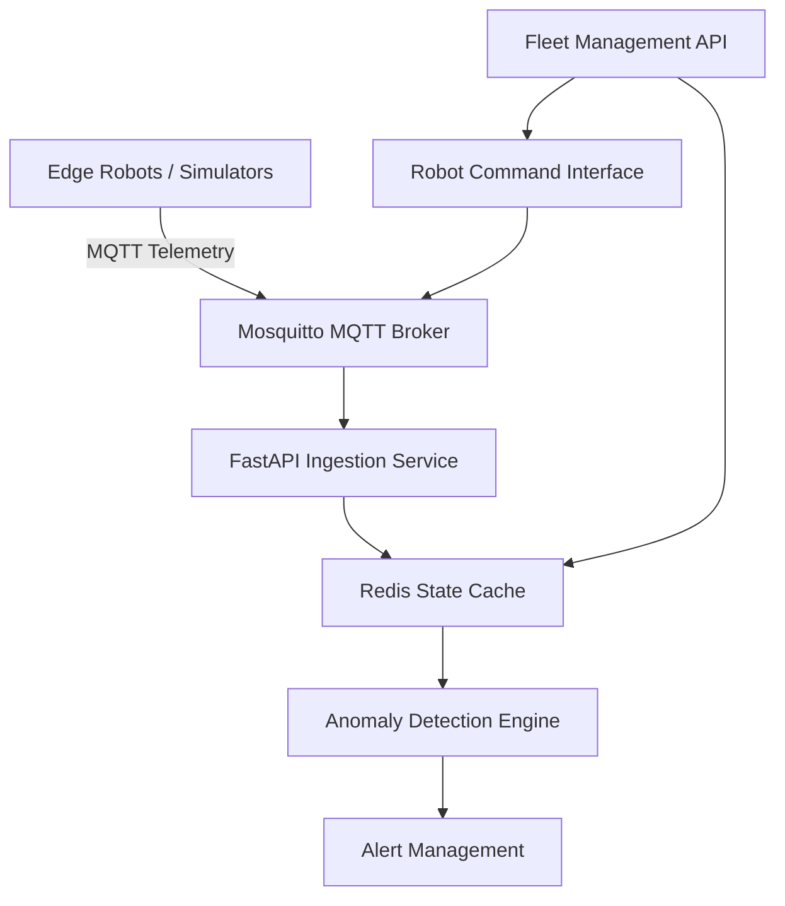

# FleetPulse-AI: Edge Telemetry & Autonomous Robot Fleet Orchestrator

High-frequency telemetry ingestion, real-time edge monitoring, and fleet command-and-control for autonomous robotics operations.

FleetPulse-AI is designed to provide a centralized platform for monitoring robot health, processing telemetry, detecting anomalies, and issuing operational commands across a fleet of autonomous robots and simulators.

## 🏗️ Architecture Overview



### How It Works

1. **Telemetry ingestion:** Robots and simulators publish telemetry messages through MQTT.
2. **Message processing:** The Mosquitto broker routes telemetry to the FastAPI ingestion service.
3. **State management:** Redis stores the latest robot states for fast access.
4. **Anomaly detection:** The monitoring engine evaluates telemetry and identifies potential operational anomalies.
5. **Fleet control:** REST API endpoints provide fleet status, robot diagnostics, alerts, and operational command interfaces.

## 🚀 Tech Stack

| Component | Technology |
|---|---|
| Language | Python 3.11+ |
| API Framework | FastAPI |
| Data Validation | Pydantic |
| Messaging Protocol | MQTT |
| MQTT Broker | Eclipse Mosquitto |
| MQTT Client | Paho-MQTT |
| State Management | Redis |
| Containerization | Docker |
| Service Orchestration | Docker Compose |
| Testing | Pytest |

## ✨ Key Features

- **Real-time telemetry ingestion** from connected robots and simulators.
- **Centralized fleet monitoring** for tracking active robot states.
- **Robot diagnostics** for inspecting individual robot telemetry.
- **Anomaly and alert management** for identifying potentially abnormal operating conditions.
- **Remote command interfaces** for operational actions such as emergency stop and resume.
- **Redis-backed state caching** for low-latency access to recent telemetry.
- **Containerized deployment** for consistent development and testing environments.

*Feature availability depends on the components implemented and configured in the current version of the project.*

## 🛠️ Quick Start

### Prerequisites

Ensure the following tools are installed:

- [Git](https://git-scm.com/)
- [Docker](https://www.docker.com/)
- [Docker Compose](https://docs.docker.com/compose/)
- Python 3.11 or later (for local development)

### 1. Clone the Repository

```bash
git clone https://github.com/mahingaRodin/FleetPulse-AI.git
cd FleetPulse-AI
```

### 2. Start the Services

Build and start the application stack:

```bash
docker compose up --build
```

This command starts the services defined in your Docker Compose configuration, which may include the Redis cache, Mosquitto MQTT broker, FastAPI backend, and robot simulators.

To run the services in the background:

```bash
docker compose up --build -d
```

### 3. Verify the Services

Once the application is running, use the following interfaces to inspect the deployment.

| Service | Address / Command |
|---|---|
| FastAPI Swagger UI | [http://localhost:8000/docs](http://localhost:8000/docs) |
| FastAPI ReDoc | [http://localhost:8000/redoc](http://localhost:8000/redoc) |
| MQTT Broker | `localhost:1883` |
| Redis CLI | `docker compose exec redis redis-cli` |

**Note:** The Redis command assumes your Compose service is named `redis`. If your service uses a different name, replace `redis` with the configured service name. MQTT clients may need additional credentials or TLS configuration depending on your deployment.

## 🔌 API Endpoints

The following endpoints describe the intended fleet-management API. Confirm the exact paths and methods against the running FastAPI application.

| Method | Endpoint | Description |
|---|---|---|
| `GET` | `/api/v1/fleet/status` | Retrieve the latest telemetry state for the fleet. |
| `GET` | `/api/v1/robots/{robot_id}` | Retrieve diagnostics for a specific robot. |
| `POST` | `/api/v1/robots/{robot_id}/command` | Submit an operational command to a robot. |
| `GET` | `/api/v1/alerts` | Retrieve active alerts generated by the monitoring system. |

### Example: Retrieve Fleet Status

```bash
curl http://localhost:8000/api/v1/fleet/status
```

### Example: Retrieve Robot Diagnostics

```bash
curl http://localhost:8000/api/v1/robots/robot-001
```

### Example: Send a Robot Command

```bash
curl -X POST \
  http://localhost:8000/api/v1/robots/robot-001/command \
  -H "Content-Type: application/json" \
  -d '{"command": "EMERGENCY_STOP"}'
```

The command payload is illustrative. Adjust it to match the request schema defined by your API.

**Safety note:** An emergency-stop command should be implemented with appropriate validation, authentication, and safety mechanisms. A software command interface alone should not be treated as a certified physical emergency-stop system.

## 🧪 Testing

Install the development dependencies in your Python environment:

```bash
python -m venv .venv
source .venv/bin/activate
pip install -r requirements.txt
```

On Windows PowerShell, activate the environment with:

```powershell
.\.venv\Scripts\Activate.ps1
```

Run the test suite:

```bash
pytest
```

Run tests with coverage reporting:

```bash
pytest tests/ --cov=app/ --cov-report=term-missing
```

These commands assume that the project includes a `requirements.txt`, a `tests/` directory, and an importable Python package named `app`. Install any additional test dependencies required by your project.

## 🐳 Container Management

Stop the running services:

```bash
docker compose down
```

Stop services and remove their Compose-managed volumes:

```bash
docker compose down --volumes
```

**Warning:** Removing volumes can permanently delete persisted application data, including Redis data if it is stored in a Compose-managed volume.

View service logs:

```bash
docker compose logs -f
```

View logs for a specific service:

```bash
docker compose logs -f backend
```

Replace `backend` with the actual FastAPI service name in your Compose configuration.

## 🔒 Security & Reliability Considerations

For deployments involving physical robots or production environments, consider implementing:

- MQTT authentication and TLS encryption.
- API authentication and role-based access control.
- Command validation and authorization.
- Telemetry validation and message timestamps.
- Safe handling of stale telemetry and disconnected robots.
- Rate limiting and audit logging for remote commands.
- Fault handling and recovery procedures for critical services.
- Independent, hardware-level safety mechanisms for emergency stops.

## 🗺️ Roadmap

Potential areas for future development include:

- [ ] Real-time fleet dashboards.
- [ ] Advanced anomaly detection and predictive maintenance.
- [ ] Robot health scoring and connectivity monitoring.
- [ ] Historical telemetry storage and analysis.
- [ ] Fleet-wide command scheduling.
- [ ] Authentication, authorization, and audit trails.
- [ ] Edge deployment and multi-site fleet management.

## 🤝 Contributing

Contributions, bug reports, and feature suggestions are welcome.

1. Fork the repository.
2. Create a feature branch.
3. Implement and test your changes.
4. Submit a pull request describing the changes.

## 📄 License

Add your chosen open-source license to the repository and reference it here. Until a license is specified, all rights remain with the copyright holder by default.

---

**FleetPulse-AI** — Building reliable telemetry and intelligent control infrastructure for autonomous robotic fleets.